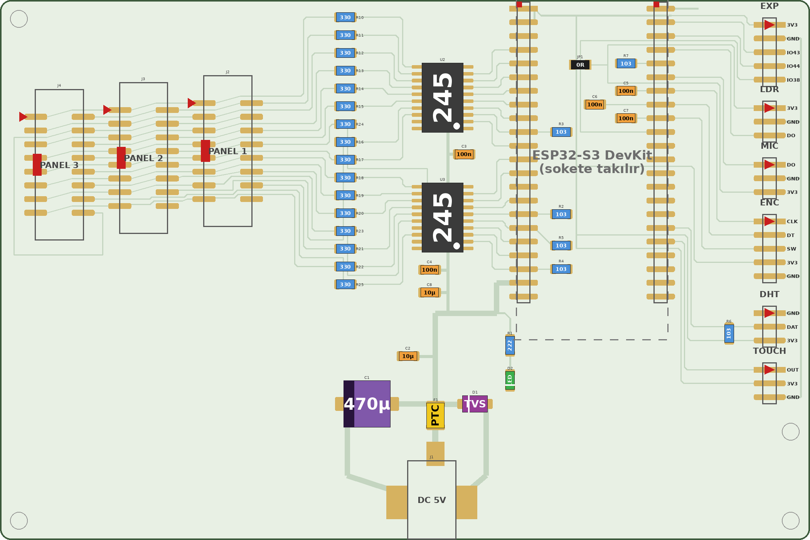

# Yalnız SMD kart, 150 × 100 mm, deliksiz: stencil + ısıtıcı tabla

Aynı şematiğin, bütün parçaları bakır yüzde olan sürümü. Kartta hiç delik yok. Bakır Saturn 3 Ultra
ile pozitif lakla, lehim maskesi de aynı yazıcıyla pozlanır. Macun reçine bir stencil'le sürülür,
parçalar yerleştirme şablonuyla dizilir ve kart ısıtıcı tablada tek seferde lehimlenir.

Ayrı KiCad projesidir (`magpanel-carrier-smt/`), çıktılar `fab-smt/` altındadır. Hepsi
`gen_carrier.py --smt all` ile üretilir. Kodu `smt_variant.py` dosyasındadır, öteki kartların
dosyalarına dokunmaz.



| | Tek yüz (`fab-ss/`) | Yalnız SMD (`fab-smt/`) |
|---|---|---|
| Kart | 150 × 100 mm | 150 × 100 mm |
| Delik | 162 (+6 isteğe bağlı) | **0** (montaj yerleri yalnız işaret) |
| Parçalar | delikli + SMD, iki yüzde | hepsi SMD, bakır yüzde |
| Tel / köprü | 3 tel | 0 tel, 1 adet 0 Ω köprü (JP1) |
| Lehim | havya | macun + ısıtıcı tabla |
| Maske | yok | UV lehim maskesi |

Doğrulama: ERC 0, DRC 0, şematik/PCB farkı 0. Tek istisna JP1'dir (aşağıda).

## Parçalar
Malzeme listesi: `fab-smt/magpanel-carrier-smt-bom.xlsx` (ve `.csv`). Kart başına adetler,
kılıf, parçanın üstündeki kod ve Komponentci'de aranacak ad yazar.

| Parça | Kılıf | Not |
|---|---|---|
| 74HCT245 × 2 | SOIC-20 geniş (7,5 mm) | HCT olmalı, HC değil |
| Dirençler, kondansatörler, LED | 1206 | %5 direnç kodu: 330, 103, 222. %1 alırsan: 33R0, 1002, 2201 |
| DevKit soketi | 2 × 1x22 SMD dişi, 2,54 mm | ped iki yöne uzanır: bacağı sola ya da sağa açılan soket de olur |
| HUB75 × 3 | SMD 2x8 kutu başlık | çentik sola (kart kenarına) bakar |
| Sensör başlıkları | SMD 1xN erkek | ped iki yöne uzanır |
| C1 | 470 µF 16 V SMD elektrolitik, 8 × 10,5 mm | |
| J1 | SMD DC jak 5,5 × 2,1 (CUI PJ-036AH-SMT ayak izi) | orta pin +5 V, fiş alt kenardan girer |
| F1, D1 | 1812 PTC, SMA TVS | |
| JP1 | 0 Ω 1206 | köprü (aşağıda) |

**Fırına dayanıklılık:** kutu başlık, dişi soket, pin başlık ve DC jakın plastiği ısıtıcı
tablaya dayanmalı ("reflow", PA9T ya da LCP). Altında plastik pim olan parçaların pimini kes: kartta
delik yok.

**DC jak:** SMD DC jakların bacak düzeni markaya göre değişir. Almadan önce bacak yerlerini
PJ-036AH-SMT çizimiyle karşılaştır ya da haritayı 1:1 basıp jakı üstüne koy.

## Yerleşim
Soldan sağa: üç HUB75 başlığı (J4 PANEL 3, J3 PANEL 2, J2 PANEL 1), 33 Ω sütunu, iki 74HCT245,
DevKit, sensör başlıkları. 5 V girişi alt kenarda.

- **Bütün izler sabit**, otomatik yönlendirici kullanılmaz: kart her üretimde aynı çıkar.
- **Kesişmeler köprüsüz çözüldü.** HUB75 hattının sırası iki yerde değişir:
  - 33 Ω dirençlerin gövdesinin altından iki iz geçer (1206 pedleri arası 1,8 mm).
  - E sinyali U3'ün gövdesinin altından yukarı çıkar.
  - Kutu başlık pedlerinin iç ucu 1 mm kısaltıldı. Gövdenin altından ve pedlerin arasından ikişer iz
    geçer. LAT2 ve LAT3 bu sayede başlıklardan telsiz geçer.
- **Sensörler:** sinyaller ve 3V3 başlıklara soldan gelir. GND kart kenarındaki hattan sağdan
  bağlanır. IO38, DevKit'in altından dolaşarak EXP başlığına gider.
- **GND** parça yüzünde döküm. Büyük bakır alanı aşındırma süresini de kısaltır.
- **Montaj yerleri** (H1–H4) bakır halka ve merkez noktasıdır, delik değildir. İstersen 3,2 mm
  delebilirsin.

### JP1 (0 Ω köprü)
EXP başlığının pin sırası (3V3, GND, IO43, IO44, IO38) ile DevKit'teki pin sırası tek katmanda bir
kesişmeyi zorunlu kılıyor. IO38, DevKit'in altından bir halka çizerek dolaşır. J5 ve J6'nın 3V3'ü
bu halkanın içinde kalır. 3V3, JP1'in gövdesinin altından IO38'in üstünden geçer.

JP1 şematikte yoktur, "yalnız kart" parçasıdır, bu yüzden şematik aynı kalır. KiCad 8 0 Ω
direnci bağlantı saymaz; KiCad 9'daki "jumper" ped özelliği 8'de yok. Bu nedenle JP1'in iki ucu
arasındaki eksik bağlantı projede **DRC istisnası** olarak kayıtlıdır. Bu istisnayı `route`
aşaması kendisi yazar, `fab` aşaması da başka hiçbir istisna olmadığını denetler.

## Dosyalar
| Dosya | İçerik |
|---|---|
| `fab-smt/saturn3/bakir-pozlama-testi.goo` | bakır süre testi: 200, 210 … 250 s (pozitif lak) |
| `fab-smt/saturn3/bakir-230s.goo` | bakır, 230 s. Testte başka süre iyi çıkarsa `bakir-200s` … `bakir-250s` |
| `fab-smt/saturn3/maske-pozlama-testi.goo` | UV maske süre testi: 60, 120 … 360 s |
| `fab-smt/saturn3/maske-60s.goo` … `maske-360s.goo` | lehim maskesi, testteki her süre için |
| `fab-smt/saturn3/cerceve.goo` | yalnız hizalama çerçevesi (deneme için) |
| `fab-smt/stencil/macun-stencil.stl` | macun stencil'i, 0,2 mm plaka + kartı saran dudak |
| `fab-smt/stencil/yerlestirme-sablonu.stl` | yerleştirme şablonu, yuvaların yanında değer kodu |
| `fab-smt/stencil/deneme-soic-1206.stl` | küçük deneme stencil'i (SOIC + 4 × 1206), önce bunu bas |
| `fab-smt/magpanel-carrier-smt-yerlesim.pdf` | renkli yerleşim haritası: sayfa 1 kartın tamamı 1:1, sayfa 2–3 iki yarı 2 kat |
| `fab-smt/magpanel-carrier-smt-bom.xlsx`, `.csv` | malzeme listesi |
| `fab-smt/magpanel-carrier-smt-gerber.zip` | F.Cu, F.Mask, F.Paste, kenar (`.gko`), hizalama çerçevesi. Delik dosyası yok |
| `img/smt-yerlesim.png` | haritanın görseli |

Her `.goo` dosyasının ilk 2 dakikasında yalnız hizalama çerçevesi yanar. Plaketi bu sürede
yerleştirirsin, pozlama sonra kendiliğinden başlar. Bakır ve maske dosyaları aynı çerçeveyi
kullanır: plaketi iki pozlamada da aynı yere koyarsın.

## Yapım

### 1. Bakır (Bungard pozitif lak)
Önce `bakir-pozlama-testi.goo` ile bir şerit dene, sonra en iyi sürenin dosyasını bas. Senin
deneyimine göre 230 s iyi; test 200–250 s aralığını kapsar.

Bakır yüz ekrana bakar. Kâğıtla provada kartın yazıları **ters** görünmeli. Banyo, aşındırma ve
lak sökme [TEK-YUZ.md](TEK-YUZ.md)'deki pozitif lak tablosundaki gibi.

Kontrol: 74HCT245 pedleri arası 0,67 mm. Pedler birbirine değmemeli. Gerekirse ölçü aletiyle
komşu pedleri dene.

### 2. UV lehim maskesi
Maskeyi bakır temiz ve kuruyken sür.

1. Mürekkebi ince ve eşit sür, üstüne şeffaf film koyup hava kabarcıklarını sıyır.
2. `maske-pozlama-testi.goo` ile bir şerit dene. Doğru sürede ince çizgiler açılır, zemin sertleşir.
3. Kartı aynı çerçeveye koyup `maske-<süre>s.goo` dosyasını bas. Pedler karanlıkta kalır,
   sertleşmez.
4. Filmi kaldır, pedlerdeki sertleşmemiş mürekkebi mürekkebin talimatındaki çözücüyle yıka.
5. Kartı UV altında son kürlemeye bırak.

Maske açıklıkları pedden kenar başına 0,1 mm büyüktür (hizalama payı).

### 3. Stencil'ler (reçine)
1. **Önce `deneme-soic-1206.stl`'i bas.** Işığa tut: SOIC'in 0,6 mm açıklıkları ayrı ayrı
   görünmeli.
2. Kapanıyorsa açıklıkları büyüt ve yeniden üret:
   ```bash
   SMT_APERTURE=0.03 $PY gen_carrier.py --smt fab
   ```
   Değer, kenar başına mm cinsindendir. Plaka kalınlığı için `SMT_STENCIL_T=0.15` kullan.
3. STL'ler basılacak yönde hazırdır. Düz yüz tablaya gelir (yazılar tablada ters görünür), dudak
   yukarı büyür. Destek gerekmez.
4. Alt katman pozlamasını düşük tut. Fazla ışık ilk katmanlarda açıklıkları daraltır.
5. Baskıdan sonra yıka, kürle, düz bir yüzeyde soğut.

### 4. Macun
1. Stencil'i karta oturt. Dudak kart kenarını sarar, "DC JAK BU KENARDA" yazısı jakın kenarına gelir.
2. Macunu bir kez, kartlı ya da plastik bir sıyırıcıyla sür.
3. Stencil'i dik kaldır.

Macun önerisi: Sn63/Pb37. Plastik konnektörleri daha az ısıtmak için düşük sıcaklık macunu
(Sn42/Bi58, 138 °C) da kullanılabilir, ama bu lehim kırılgandır. Takıp çıkarılan soket ve başlıklar
için Sn63/Pb37 daha sağlam olur.

### 5. Yerleştirme
1. Şablonu oturt: dudak kart kenarını sarar, ayakları montaj işaretlerine ve boş yerlere basar,
   macuna değmez.
2. Küçük parçaları yuvalarına koy. Her yuvanın yanında değer kodu yazar (330, 103, 222, 100n, 10µ,
   0R, LED, TVS, PTC, 245, 470µ).
   - Kutuplu parçalarda: "1" 74HCT245'in pin 1'i, "K" diyot ve LED'in katodu, "+" C1'in artısıdır.
   - C1'in yuvası pahlı: ters girmez.
   - Seramik kondansatörlerde yazı yok. 100n ile 10µ'yü ayrı tut.
3. Şablonu dik ve yavaş kaldır. Macun parçaları yerinde tutar. Hafif kaymalar lehimde kendiliğinden
   düzelir.
4. Büyük parçaları elle koy, haritaya bak:
   - kutu başlıklar: çentik sola
   - DevKit soketleri ve sensör başlıkları: kırmızı üçgen = pin 1
   - DC jak
5. Isıtıcı tabla, Sn63/Pb37 için:
   - 150 °C'de 60–90 s ön ısıtma
   - 215–225 °C'ye çık; lehim parlayınca 20–30 s sonra kapat
   - Kartı yerinden oynatmadan soğut

### 6. Kontrol
- **Ölçü aletiyle, DevKit takılmadan:** +5V–GND, 3V3–GND, 74HCT245 komşu pinleri arasında kısa
  devre olmamalı. 3V3'ü J5.1 ile JP1'in iki ucu arasında da ölç: 0 Ω olmalı.
- Sonra [README](README.md)'deki ilk açılış adımları.

## Doğrulama
`gen_carrier.py --smt route` ve `fab` her seferinde şunları kontrol eder:

- **ERC 0, DRC 0 ihlal, 0 bağlanmamış, şematik farkı 0.** Tek istisna JP1'dir; başka istisna varsa
  hata verir.
- **Pozlama:** çerçeve ekranın ortasındadır, bakır ve maske görüntüsünde aynı yerdedir. Pozitif
  görüntü kartın içinde negatifinin tam tersidir.
- **Şablon:** her macun açıklığı bir yuvanın içindedir; ayaklar yuvalardan uzaktır.
- Aynı girdi her seferinde aynı dosyaları verir.

Donanımda henüz denenmedi. İlk denemede doğrulanacaklar:
- bakır ve maske süreleri
- stencil açıklıklarının baskı ölçüsü
- SMD DC jak ve kutu başlıkların bacak düzeni
- ısıtıcı tablada konnektör plastiklerinin dayanımı
